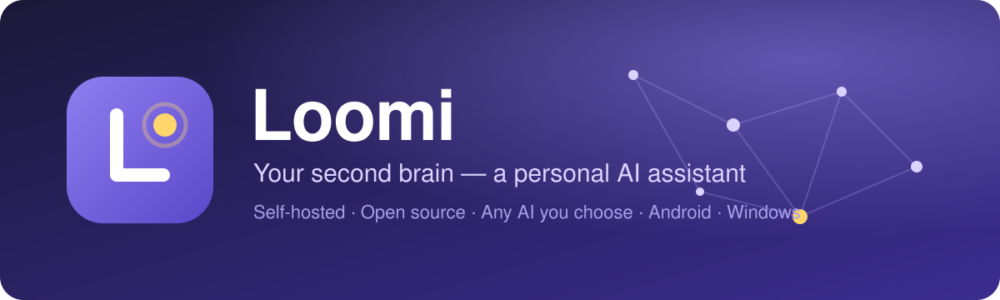
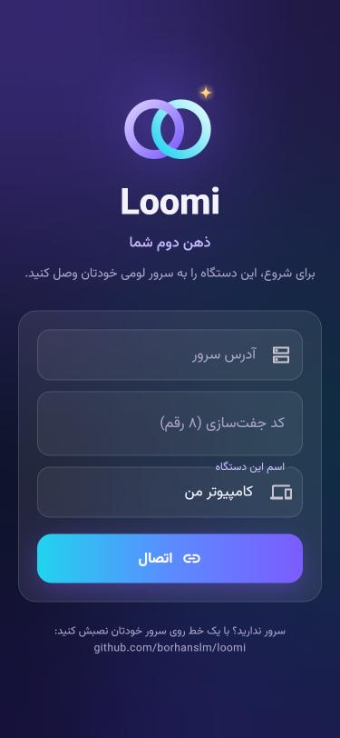
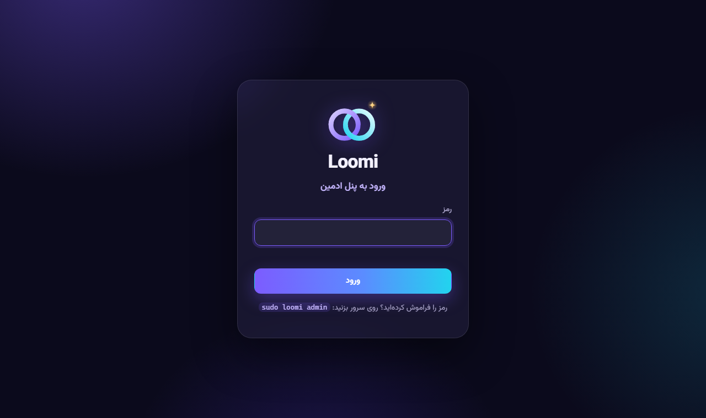

<p align="center">
  
</p>

<p align="center">
  <a href="https://github.com/borhanslm/loomi/releases/latest"></a>
  <a href="LICENSE"></a>
  
  
  
</p>

<p align="center"><a href="README.md">فارسی</a> · <b>English</b></p>

<h1 align="center">Loomi — your second brain</h1>

<p align="center">
A personal AI assistant that is <b>free, open source and self-hosted</b>, built Persian-first.<br>
Just say what's on your mind. Loomi understands it, organizes it, reminds you at the right time, and gradually gets it done for you.
</p>

<p align="center">
  <a href="https://github.com/borhanslm/loomi/releases/latest/download/Loomi.apk"></a>
  <a href="https://github.com/borhanslm/loomi/releases/latest/download/Loomi-Setup.exe"></a>
</p>

---

## Why Loomi?

| | |
|---|---|
| 🧠 **A second brain** | Ideas, tasks, reminders, shopping and thoughts, all in one place. No sorting needed. |
| 🏠 **Yours** | Runs on your own server. Your data and keys stay with you, not with a company. |
| 🔌 **Any AI you like** | Pick a provider per job: Claude for the brain, ElevenLabs for the voice, OpenAI for listening… |
| 🗣️ **Really Persian** | Designed for Persian and right-to-left from day one. |
| 🔒 **Safe and transparent** | Keys are encrypted, sensitive actions need your approval, and every action is logged. |
| 💚 **Free and open** | Nothing is sold. The code is available to everyone under AGPL-3.0. |

## Supported AI providers

<p>


</p>

Add your own keys in the admin panel. For each capability (brain, listening, voice, memory, vision), choose a main model and a fallback.

## Install in 3 steps

**1. The server, in one line** (Ubuntu or Debian; everything it needs is installed for you):

```bash
curl -fsSL https://raw.githubusercontent.com/borhanslm/loomi/main/deploy/get.sh | sudo bash
```

<details>
<summary>What does it do?</summary>

- Installs Docker. If Docker Hub can't be reached, it installs without Docker instead.
- Asks for your domain and gets HTTPS automatically. Without a domain, it works on the server's IP.
- Creates the passwords and the encryption key.
- Prints the admin panel link and a pairing code at the end.
- Run the same line again to update. Your data and keys are kept.

</details>

**2. The apps**, from the [latest release](https://github.com/borhanslm/loomi/releases/latest). Everything is inside each file:
- Android: [`Loomi.apk`](https://github.com/borhanslm/loomi/releases/latest/download/Loomi.apk)
- Windows: [`Loomi-Setup.exe`](https://github.com/borhanslm/loomi/releases/latest/download/Loomi-Setup.exe)

**3.** In the admin panel (`https://your-domain/admin`), add your AI key and pair your phone with the QR code.

## App and admin panel

<p align="center">
  
  &nbsp;
  
</p>

Managing the server over SSH is one word:

```bash
loomi            # menu: status, admin link, pair a device, logs, update, backup
```

## Roadmap

- [x] **Server and admin panel:** one-line install, HTTPS, AI keys, QR device pairing
- [x] **Android and Windows apps:** secure connection to your server
- [x] **Capture and understand:** say or type anything; Loomi turns it into tasks, reminders, shopping and ideas
- [ ] **Reminders:** timely notifications, a morning brief and an evening review
- [ ] **Voice:** talk to Loomi and hear it answer in the voice you choose
- [ ] **"Hey Loomi"**, even with the screen off
- [ ] **Your life, connected:** calendar, email, SMS, messengers
- [ ] **Getting things done:** messages, orders, actions in apps, and later phone calls

Full roadmap (Persian): [docs/ROADMAP.md](docs/ROADMAP.md)

## Contributing

Loomi is open source and contributions are welcome. To run it locally:

```bash
cd server && npm install && npm run dev     # server with a built-in database, no Docker needed
cd server && npm test
cd app && flutter pub get && flutter test
```

Repository layout: `server/` (TypeScript, Fastify, PostgreSQL), `app/` (Flutter), `deploy/` (installers), `docs/` (roadmap and [API contract](docs/openapi.json)).

## License

Copyright © 2026 the Loomi author. Released under the **[GNU AGPL-3.0](LICENSE)**: anyone may use, change and share Loomi, as long as their own code stays open and the author's name is kept. The Loomi name and logo are trademarks, separate from the code.
