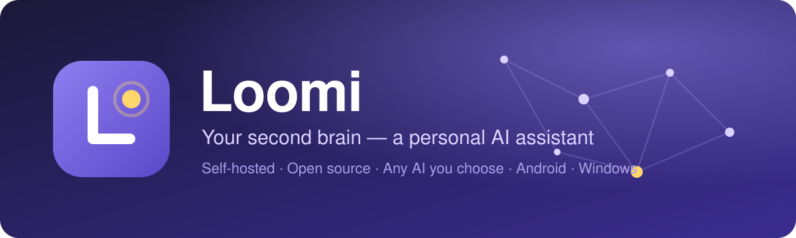
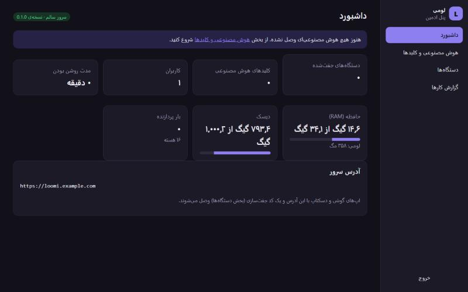
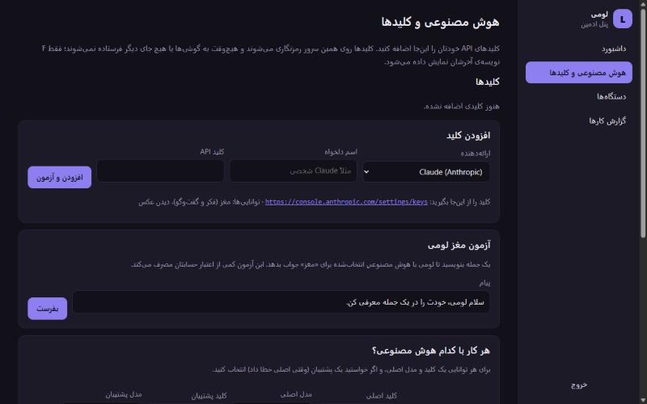
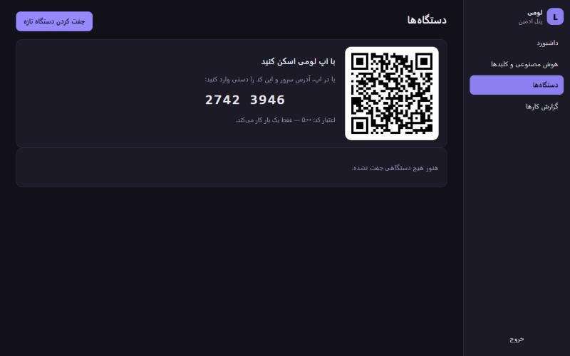

<p align="center">
  
</p>

<p align="center">
  <a href="https://github.com/borhanslm/loomi/releases/latest"></a>
  <a href="LICENSE"></a>
  
  
  
</p>

<p align="center"><b>فارسی</b> · <a href="README.en.md">English</a></p>

<div dir="rtl">

<h1 align="center">لومی؛ ذهن دوم شما</h1>

<p align="center">
دستیار هوش مصنوعی شخصی، فارسی‌زبان، <b>رایگان و متن‌باز</b>.<br>
هر چه در ذهنتان می‌گذرد را فقط بگویید؛ لومی می‌فهمد، مرتب می‌کند، به‌موقع یادتان می‌آورد و کم‌کم خودش انجامش می‌دهد.
</p>

<p align="center">
  <a href="https://github.com/borhanslm/loomi/releases/latest/download/Loomi.apk"></a>
  <a href="https://github.com/borhanslm/loomi/releases/latest/download/Loomi-Setup.exe"></a>
</p>

---

## چرا لومی؟

| | |
|---|---|
| 🧠 **ذهن دوم** | ایده‌ها، کارها، یادآورها، خریدها و فکرها؛ همه در یک جا، بدون این‌که خودتان دسته‌بندی کنید. |
| 🏠 **مال خود شما** | لومی روی سرور خودتان اجرا می‌شود. داده‌ها و کلیدها پیش خودتان می‌ماند، نه پیش یک شرکت. |
| 🔌 **هر هوش مصنوعی‌ای که بخواهید** | برای هر کار ارائه‌دهنده‌ی دلخواهتان: مغز با Claude، صدا با ElevenLabs، شنیدن با OpenAI… |
| 🗣️ **فارسی واقعی** | از اول برای فارسی و راست‌به‌چپ ساخته شده. |
| 🔒 **امن و شفاف** | کلیدها رمزنگاری‌شده، کار حساس فقط با تأیید شما، و گزارش هر کاری که لومی انجام می‌دهد. |
| 💚 **رایگان و متن‌باز** | هیچ چیزی فروخته نمی‌شود. کد زیر مجوز AGPL-3.0 در دسترس همه است. |

## هوش مصنوعی‌های پشتیبانی‌شده

<p>


</p>

کلید خودتان را در پنل ادمین می‌گذارید و برای هر توانایی (مغز، شنیدن، صدا، حافظه، دیدن عکس) یک مدل اصلی و یک پشتیبان انتخاب می‌کنید.

## نصب در ۳ قدم

**۱. سرور، با یک خط** (Ubuntu یا Debian؛ همه‌ی پیش‌نیازها خودکار نصب می‌شوند):

```bash
curl -fsSL https://raw.githubusercontent.com/borhanslm/loomi/main/deploy/get.sh | sudo bash
```

<details>
<summary>این دستور چه می‌کند؟</summary>

- Docker را نصب می‌کند. اگر Docker Hub در دسترس نباشد (مثل سرورهای داخل ایران)، خودکار بدون Docker نصب می‌کند.
- اسم دامنه را می‌پرسد و HTTPS را خودکار می‌گیرد. بدون دامنه، با IP سرور کار می‌کند.
- رمزها و کلید رمزنگاری را می‌سازد.
- آخر کار، لینک پنل ادمین و کد جفت‌سازی را نشان می‌دهد.
- برای به‌روزرسانی، همین خط را دوباره اجرا کنید. داده‌ها و کلیدها می‌مانند.

</details>

**۲. اپ‌ها** را از [آخرین نسخه](https://github.com/borhanslm/loomi/releases/latest) بگیرید. همه‌چیز داخل خود فایل‌هاست:
- اندروید: [`Loomi.apk`](https://github.com/borhanslm/loomi/releases/latest/download/Loomi.apk)
- ویندوز: [`Loomi-Setup.exe`](https://github.com/borhanslm/loomi/releases/latest/download/Loomi-Setup.exe)

**۳.** در پنل ادمین (`https://دامنه‌ی-شما/admin`) کلید هوش مصنوعی‌تان را اضافه کنید و گوشی را با QR جفت کنید.

## پنل ادمین

<p align="center">
  
  
  
</p>

## نقشه‌ی راه

- [x] **سرور و پنل ادمین:** نصب یک‌خطی، HTTPS، کلیدهای هوش مصنوعی، جفت کردن دستگاه با QR
- [x] **اپ اندروید و ویندوز:** اتصال امن به سرور
- [ ] **گرفتن و فهمیدن:** بگویید یا بنویسید؛ لومی کار و یادآور و خرید و ایده می‌سازد
- [ ] **یادآوری:** نوتیف به‌موقع، خلاصه‌ی صبح و مرور شب
- [ ] **صدا:** حرف زدن با لومی، و جواب با صدای دلخواه
- [ ] **«هی لومی»** حتی با صفحه‌ی خاموش
- [ ] **اتصال به زندگی:** تقویم، ایمیل، پیامک، پیام‌رسان‌ها
- [ ] **انجام کار:** پیام، سفارش، کار روی اپ‌ها؛ و بعدها تماس تلفنی

نقشه‌ی کامل: [docs/ROADMAP.md](docs/ROADMAP.md)

## مشارکت

لومی متن‌باز است و از مشارکت شما استقبال می‌کند. برای اجرای محلی:

```bash
cd server && npm install && npm run dev     # سرور با پایگاه داده‌ی داخلی، بدون Docker
cd server && npm test
cd app && flutter pub get && flutter test
```

ساختار مخزن: `server/` (TypeScript، Fastify، PostgreSQL)، `app/` (Flutter)، `deploy/` (نصب)، `docs/` (نقشه‌ی راه و [قرارداد API](docs/openapi.json)).

## مجوز

کپی‌رایت © ۲۰۲۶ سازنده‌ی لومی. منتشرشده تحت مجوز **[GNU AGPL-3.0](LICENSE)**: هر کس می‌تواند از لومی استفاده کند، آن را تغییر دهد و منتشر کند، به شرط این‌که کد خودش هم باز بماند و نام سازنده حفظ شود. نام و نشان «لومی» علامت تجاری است و جدا از کد است.

</div>
